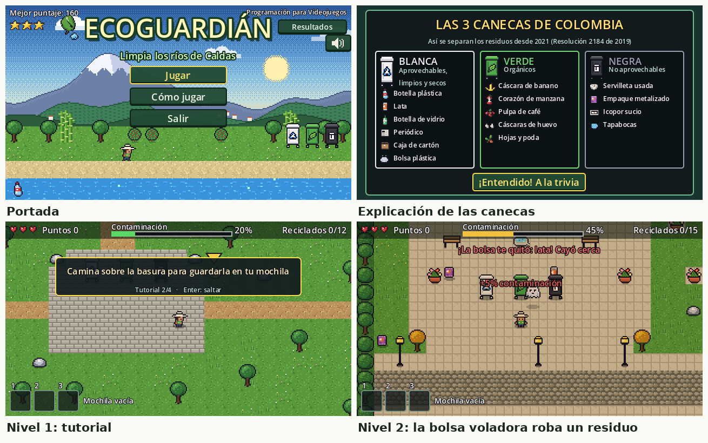

# EcoGuardián · Limpia los ríos de Caldas

Videojuego educativo 2D hecho en **Godot 4.4**. Eres un EcoGuardián con sombrero aguadeño
que limpia los ríos de Caldas: recoges la basura del suelo y la que baja por el río y la
llevas a la caneca correcta según el **código de colores de Colombia (Resolución 2184 de 2019)**.
Si dejas que el río se contamine, pierdes.

**▶ Jugar en el navegador:** https://ecoguardian-fawn.vercel.app/

## Qué tiene el juego

- **2 niveles:** la finca cafetera (recicla 12 residuos) y el pueblo colonial (recicla 15),
  con paisajes, ríos y música distintos (bambuco y cumbia).
- **2 enemigos:** la mancha de petróleo y la bolsa voladora, que te quita residuos.
- **Imán:** atrae la basura cercana, también la del río.
- **Tutorial** de 4 pasos al inicio.
- **Evaluación del aprendizaje:** explicación de las 3 canecas, trivia inicial, trivia final
  con preguntas distintas, encuesta de experiencia y panel de resultados para el docente con
  exportación a CSV.
- Arte pixel, música y efectos **originales**, generados con código.

## Controles

| Acción | Tecla |
| --- | --- |
| Moverse | W A S D o flechas |
| Depositar en la caneca | E |
| Elegir residuo | 1, 2, 3, Q o Tab |
| Disparar burbujas | Espacio o clic |
| Pausa | Esc o P |
| Silenciar | M |

## Abrir el proyecto en Godot

1. Instala [Godot 4.4](https://godotengine.org/download) o superior (versión estándar).
2. Descarga este repositorio (**Code → Download ZIP**) o clónalo con `git clone`.
3. En Godot pulsa **Importar** y elige el archivo `project.godot`.
4. Pulsa **F5** para jugar.

La versión web ya exportada está en `build/web/` y se publica en Vercel con `vercel.json`.
La documentación técnica completa (estructura, reglas, cómo cambiar niveles, evaluación y
cómo volver a exportar) está en **[LEEME.md](LEEME.md)**.

## Equipo

Proyecto Final · Programación para Videojuegos

- Joiner Pineda Torres
